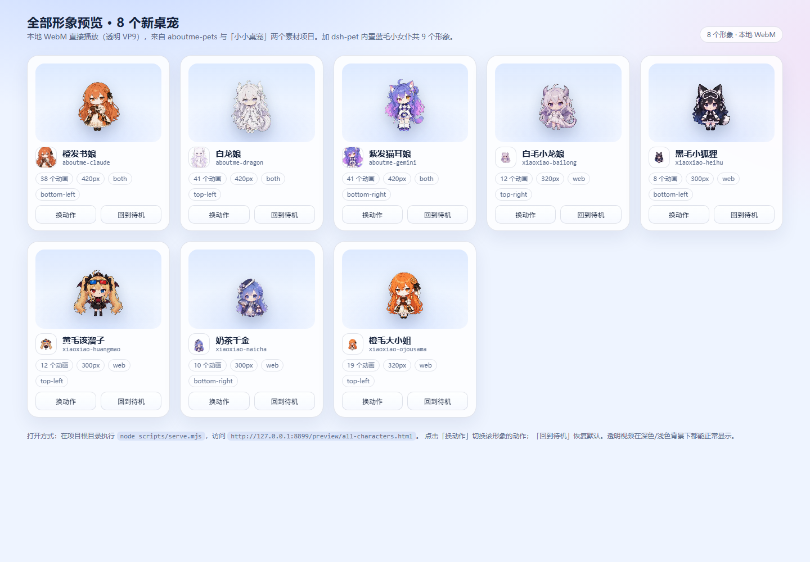

# pamper

> 给 [DeepSeek Harness](https://github.com/deepseek-ai) 的 [dsh-pet](https://github.com/PC2005-cloud/dsh-pet) 插件扩展**新形象**的工程：把 [aboutme-pets](https://github.com/hunmer/aboutme-pets) 商店的 WebP 精灵图动画转换成透明 WebM，并把[小小桌宠](https://github.com/yshuang722-spec/xiaoxiao-zhuochong)（xiaoxiao-zhuochong）的现成透明 WebM 规范化，统一下载/生成为 dsh-pet 可直接加载的 **pet pack**。装好后，**8 个新形象 + dsh-pet 内置的蓝毛小女仆**可以同屏出现。

- **这不是一个独立的桌宠程序**，而是 dsh-pet 的「形象包（pet pack）」生产 + 安装工具链。
- 产出 **8 个新 pet pack**：
  - aboutme 系列（精灵图转 WebM）：**白龙娘**、**橙发书娘**、**紫发猫耳娘**；
  - xiaoxiao 系列（现成 WebM 规范化）：**橙毛大小姐**、**黄毛该溜子**、**白毛小龙娘**、**黑毛小狐狸**、**奶茶千金**。
- **8 个新 pack 默认 `display=none`（不显示）**：首次安装或每次开机**只会看到 dsh-pet 内置的蓝毛小女仆一只**；8 个形象都在「设置 → 桌宠配置 → 种类」里列着，想显示哪只就把它的「显示位置」改成 仅桌面/仅浏览器/两者并保存。开启后可同屏 9 个形象。
- 可选补丁：给 dsh-pet 的桌面窗口与网页 overlay 右键菜单加「退出回家」——点一下让**这一只**退出（display 置 none），其它宠物不受影响，可在设置页重新开启。
- 运行期补丁（`node scripts/patch-dsh-pet.mjs`）：主菜单新增 **「宠爱」** 入口（直接打开桌宠配置）、设置页「种类」按型号分组（deepseek / GPT / Claude / Gemini / kimi / 豆包 / 其他）、内置宠物改名 **大肥鱼**、每只宠物右键 **「退出回家」**。
- 两个预览页：`preview/`（aboutme 4 形象精灵图舞台）与 `preview/all-characters.html`（8 个新形象本地 WebM 卡片）。
- 素材**优先读本地**（`D:\PC\DSH\桌面宠物源代码\pet素材` 与 `...\xiaoxiao-zhuochong桌面源代码`），本地齐全时可完全离线构建；本地缺失才回退 jsDelivr / raw.githubusercontent。
- 纯 Node.js 脚本（零 npm 依赖）+ ffmpeg，Windows 上一键构建、安装、卸载。

> **项目最终位置：`D:\PC\DSH\pamper`。** 下文命令均以该项目根目录为当前目录执行。

### 收录到社区插件市场（awesome-dsh-plugin）

已向 `LingHXiao/awesome-dsh-plugin` 提交收录 PR：

- PR：https://github.com/LingHXiao/awesome-dsh-plugin/pull/2
- 合并后，dsh-market 的「发现」会自动抓取该目录（通常一天内），即可搜索 **Ai-nice/dsh-pamper** 并一键安装。

> 网络无法访问 GitHub raw 时（安装报 TLS/无法连接 raw.githubusercontent.com），请用 jsDelivr 的 tgz 直链安装：
> ```text
> https://cdn.jsdelivr.net/gh/Ai-nice/dsh-pamper@main/plugin-tarballs/dsh-pamper.tgz
> ```

### npm 包（推荐，最简单）

插件已发布到 npm：**`dsh-pamper@0.1.0`**

- DSH「添加插件」直接填 **`dsh-pamper`** 即可安装，不需要访问 GitHub；
- 国内可用 npmmirror 镜像；
- 已实测 `pnpm install dsh-pamper@0.1.0` 安装成功（包内含动作目录）。

### 更新（无需卸载再安装）

- 只有通过 **npm 包名** 安装的插件（profile 记录为 `dsh-pamper@x.y.z`）才会被 DSH 标记为可更新；
- 每次发版更新 version 并 npm publish 后，已安装用户的插件页/市场会出现**更新图标**；
- 点击更新走 DSH 的 updateBundle，自动替换版本，无需手动卸载；
- 如果之前用 GitHub 地址、tarball 直链或本地路径安装，需要**一次性**卸载后改用 `dsh-pamper` 安装，之后才能自动更新。

## DSH 插件市场（自定义索引）

官方目前**没有公共插件索引**；其他插件也是通过「索引源」被发现。添加下面这个索引地址后，就能在插件市场里直接搜索并安装 **pamper**：

```text
https://raw.githubusercontent.com/Ai-nice/dsh-pamper/main/market-index.json
```

步骤：

1. 打开 DSH 侧栏 **插件**；
2. 若没有「发现」标签页：在实验性插件中启用 **自定义插件索引**（`@deepseek-ai/dsh-experimental-plugin-market-bundle`）；
3. **发现 → 添加索引源**，粘贴上面的 URL；
4. 搜索 **pamper**，点安装（包名 `dsh-pamper`，来自 GitHub 仓库 `plugins/dsh-pamper`）。

> 安装的是动作库插件（发现页动作按需加载的后端）。宠爱页面的 UI 补丁仍由项目里的 `scripts/patch-dsh-pet.mjs` 提供；基础形象包在 Release 的 `pets-base.zip`。

## GitHub 轻量发布 / 快速安装（三层结构）

本项目已按「轻仓库 + Release 基础包 + 联网按需动作」整理：

| 层 | 内容 | 大约体积 | 放哪里 |
|---|---|---:|---|
| ① 轻量仓库 | 代码、脚本、插件、目录、预览、文档 | 约 12–15 MB | 主 GitHub 仓库 |
| ② 基础形象 | 8 个 pack 的预转换 WebM | 约 203 MB | GitHub Release：`pets-base.zip` |
| ③ 完整动作库 | 819 个动作的预转换 WebM | 约 0.9 GB | 单独的 assets 仓库（CDN/jsDelivr） |

用户安装：

```powershell
git clone https://github.com/Ai-nice/dsh-pamper.git
cd pamper
node scripts/install-lite.mjs   # 自动从 Release 下载 pets-base.zip 并安装
# 再在 DSH 里安装 plugins/dsh-pamper（一次）
```

之后打开 **宠爱 → 发现**，点动作「加载」时插件会从 `assetBaseUrl` 下载对应 WebM 到本地缓存再安装，**不需要 ffmpeg、不需要下载整个素材库**。

发布者步骤（准备主仓库、assets 仓库、Release、填写地址）见 [docs/publish-github.md](docs/publish-github.md)（打包命令：`node scripts/pack-release.mjs`）。


## 宠爱入口 / 型号分组 / 改名（运行期补丁）

`node scripts/patch-dsh-pet.mjs` 给**已安装的 dsh-pet** 打一组运行期补丁（幂等，自动备份 `*.dshpet-backup`；dsh-pet 升级后重跑）：

| 改动 | 效果 |
| --- | --- |
| 主菜单「宠爱」 | 左侧主菜单新增「宠爱」；页面顶部两个标签：**角色**（角色预览卡片 + 显示/隐藏开关）与 **桌宠配置**（原有配置页，完全不变） |
| 型号分组 | 设置页「种类」条按型号分组：**deepseek / GPT / Claude / Gemini / kimi / 豆包 / 其他**（豆包暂空）；同组可放多只不同形象，例如 GPT=白龙娘+白毛小龙娘，Claude=橙发书娘+橙毛大小姐 |
| 内置改名 | 内置蓝毛小女仆显示名改为 **大肥鱼**，并把 main 设为桌面显示，保证开机有一只 |
| 退出回家 | 每只宠物右键菜单新增「退出回家」，点一下只让这一只退出（display 置 none），设置页可再开启 |

分组归属（改 `config/xiaoxiao.mjs` / `config/characters.mjs` 的位置不影响这个映射；映射写在补丁脚本里）：

| 型号 | 形象 |
| --- | --- |
| deepseek | 大肥鱼（main，内置） |
| GPT | aboutme-dragon 白龙娘、xiaoxiao-bailong 白毛小龙娘 |
| Claude | aboutme-claude 橙发书娘、xiaoxiao-ojousama 橙毛大小姐 |
| Gemini | aboutme-gemini 紫发猫耳娘 |
| kimi | xiaoxiao-huangmao 黄毛该溜子 |
| 豆包 | （暂空） |
| 其他 | xiaoxiao-heihu 黑毛小狐狸、xiaoxiao-naicha 奶茶千金 |

```powershell
node scripts/patch-dsh-pet.mjs            # 应用全部补丁
node scripts/patch-dsh-pet.mjs --check    # 检查状态
node scripts/patch-dsh-pet.mjs --revert   # 还原（含 main-config 与包内 config.jsonc）
```

> 补丁改的是 dsh-pet 插件运行期文件（`runtime/electron-helper/sprite/menu.js` 与 `lib/client.js`）+ 用户 `main-config.jsonc`；插件升级/重装会覆盖，需要重跑。刷新 DSH 页面（Ctrl+F5）后生效。
- 「宠爱」页的**角色页**：右上角是官方同款圆形「刷新」图标 + 深色「＋ 添加角色 ▾」按钮；副标题为「一碗碗大米饭就是对你的宠爱…」；「角色 / 桌宠配置」为胶囊分段切换。统计栏保持**一行**：**「N 位角色 · M 个正在桌面陪伴」**（随开关实时变化）+「刷新列表 / 全部开启 / 全部隐藏」三个按钮（白底描边，鼠标悬停变黑底白字，点击即执行）。每个角色一张预览卡（角色图 + 「N 个动作 · 独立角色项目」+ 右上角「详情」文字链），**三列网格**、可纵向滚动；与官方插件页一致的开关（40×22 胶囊轨道 + 18px 白色圆形圆钮；开启=深黑轨道，关闭=浅灰轨道，0.2s 平滑滑动）控制显示（开启 = 只在桌面显示并只开该角色第一只实例，关闭 = 全部实例隐藏），卡片左上角显示「已隐藏」。点「详情」会切到「桌宠配置」并自动选中这个角色。
- 「宠爱」页的**桌宠配置页**：与「设置 → 桌宠配置」完全同一套页面，功能不变（分组、实例、大小、位置、显示方式、保存等），宽度自适应页面。
## 发现：动作按需加载（dsh-pamper 插件）

除了「角色 / 桌宠配置」，宠爱页新增 **「发现」** 第三页：从 `assets/pet-store/` 的完整动作库（4 角色 / 6 动作包 / **819 个动作**：小女仆 268、白龙娘 285、橙发书娘 166、紫发猫耳娘 100）里挑动作，按需转成透明 WebM 并加载进对应形象。

- **动作库与已安装分离**：`assets/pet-store/` 保存原始精灵图；未加载的动作不转换、不安装，只出现在发现页。
- **三种加载粒度**：单个动作、整分类（「加载本分类」）、整角色（「加载该角色全部」）；已加载的动作显示为「已加载」并禁用按钮。
- **按需转换**：点击加载时由本地插件调用 ffmpeg 把精灵图转成 VP9 透明 WebM（单个动作约 10–60 秒，长动作更久），写入对应 pack 的 animation 目录并合并 config，最后自动通知 dsh-pet 重载。
- **小女仆 = 大肥鱼**：动作库里的小女仆就是主形象「大肥鱼」，不再单独创建 `aboutme-maid`；发现页加载小女仆动作会直接写进 main（`main-config.jsonc` + `main-animation/`），同一角色只保留一个形象。

### 插件安装

发现页的后端是项目内的小型 DSH host 插件 `plugins/dsh-pamper/`（注册 `/dsh-pamper-7462/*` 路由）。安装一次即可：

```powershell
# 在 DSH 里通过 plugin_manager install_bundle 安装（target 用绝对路径）
# C:\...\pamper\plugin\dsh-pamper
```

插件读取的路径写在 `plugins/dsh-pamper/cordis.patch.yml`：`storeRoot`（动作库）与 `catalogPath`（发现页目录），项目移动后改这两个路径并重装插件即可。


## 目录

- [效果与工作原理](#效果与工作原理)
- [形象清单与默认布局](#形象清单与默认布局)
- [前置条件](#前置条件)
- [快速开始](#快速开始)
- [多形象同屏与管理](#多形象同屏与管理)
- [目录结构](#目录结构)
- [构建流程](#构建流程)
- [脚本与参数速查](#脚本与参数速查)
- [进阶用法](#进阶用法)
- [故障排查](#故障排查)
- [许可与署名](#许可与署名)
- [相关链接](#相关链接)

## 效果与工作原理

dsh-pet 会扫描 `%DSH_HOME%\dsh-pet\pet\` 目录，把每一组

```
pet\<前缀>-config.json       ← pet pack 配置（宠物实例 + 动画池）
pet\<前缀>-animation\*.webm  ← 该形象专属的透明动画素材
pet\<前缀>-avatar.png        ← 可选：角色头像（xiaoxiao 系列自带）
```

识别为一个新的「种类」（素材根 = 文件名前缀）。安装本项目后，DSH 设置页的「桌宠配置 → 种类」条里会多出 8 个可切换的种类，宠物列表里也对应多出 8 只实例；dsh-pet 自带的蓝毛小女仆仍在 `main` 条目里，不受影响。

### 默认显示策略：只开一只（display=none）

本项目的 8 个 pack 默认 **`display = none`（都不显示）**。因此：

- 首次安装、以及之后每次开机，**只会看到 dsh-pet 内置的蓝毛小女仆一只**（本机 `main` 当前配置为仅桌面），不会满屏；
- 8 个种类仍完整列在「设置 → 桌宠配置 → 种类」里（`display=none` 不影响种类列表），实例也在宠物列表里；
- 想显示某个形象：**设置 → 桌宠配置 → 种类** 里选中它 → 在「宠物配置」把 **显示位置** 从「都不显示」改成 **仅桌面 / 仅浏览器 / 两者** → 点「保存」。桌面端保存后 Helper 会重载/重启，宠物窗口随之出现；
- 8 个全部开启时共 9 个形象可同屏；桌面模式实际开几个透明窗由各实例的 `display` 决定（只在浏览器就选「仅浏览器」，避免开太多 Electron 窗口）。

> 若你把 `main` 也改成了 `both`/`web`，浏览器 overlay 会多出蓝毛小女仆一只；以上按本机当前 `main-config.jsonc`（仅桌面）描述。

安装后即可使用 dsh-pet 的全部互动：拖拽/抛掷、点击回应、余额动画、工作状态联动、碎碎念、多宠物互撞等。aboutme 三个形象默认关闭了余额与碎碎念（避免额外模型调用），工作状态联动开启；xiaoxiao 五个形象默认关闭余额/碎碎念/工作状态联动（它们的动画池较小，以随机小动作与点击回应为主）。

## 形象清单与默认布局

| 种类（pack 前缀） | 中文名 | 素材来源 | 动画数 | WebM 体积 | display（默认） | 开启后的默认落位（角落 + 偏移 px） |
| --- | --- | --- | --- | --- | --- | --- |
| `aboutme-dragon` | 白龙娘 | aboutme-pets：`gpt1`（必需）+ `gpt`（补充小动作） | **41** | 58.3 MiB | **none** | 左上角 24, 100 |
| `aboutme-claude` | 橙发书娘 | aboutme-pets：`claude` | **38** | 47.9 MiB | **none** | 左下角 24, 100 |
| `aboutme-gemini` | 紫发猫耳娘 | aboutme-pets：`gemini` | **41** | 52.5 MiB | **none** | 右下角 24, 100 |
| `xiaoxiao-ojousama` | 橙毛大小姐 | xiaoxiao-zhuochong：`ojousama` | **19** | 18.2 MiB | **none** | 左上角 480, 100 |
| `xiaoxiao-huangmao` | 黄毛该溜子 | xiaoxiao-zhuochong：`character3` | **12** | 9.0 MiB | **none** | 左上角 24, 370 |
| `xiaoxiao-bailong` | 白毛小龙娘 | xiaoxiao-zhuochong：`character4` | **12** | 8.8 MiB | **none** | 右上角 540, 100 |
| `xiaoxiao-heihu` | 黑毛小狐狸 | xiaoxiao-zhuochong：`character5` | **8** | 3.7 MiB | **none** | 左下角 480, 100 |
| `xiaoxiao-naicha` | 奶茶千金 | xiaoxiao-zhuochong：`character6` | **10** | 4.1 MiB | **none** | 右下角 480, 100 |
| `main`（内置，不安装） | 蓝毛小女仆 | dsh-pet 自带 + aboutme-pets 的 `dsh` 动作包（仅预览页用） | —（内置素材） | — | 由用户配置决定（本机仅桌面） | 右上角 24, 100（dsh-pet 默认） |

说明：

- **8 个新 pack 的 `display` 全部是 `none`：默认不显示**。安装后只会看到内置小女仆一只；到设置页逐只开启（见「默认显示策略」）。「开启后的默认落位」是启用后 dsh-pet 记录的默认角落与偏移，可在设置页再调。
- **8 个新 pack 合计 181 个动画、约 202.6 MiB WebM**（640×360、VP9-alpha；aboutme 为 12fps，xiaoxiao 保持源帧率）。以上数值以 `dist/manifest.json` 的 `totals`/`packs` 为准；整个项目目录约 429 MiB（含约 217 MiB 精灵图缓存）。
- 「动画数」是实际安装到 pet 目录的 `.webm` 文件数；aboutme 由 `config/characters.mjs` 的选材规则决定（`random.max = 18`、`perCategory = 2`），xiaoxiao 由上游 `config.json` 规范化后决定（缺失的动画名会被丢弃）。
- 每个 pack 的单只实例 id 为 `<种类>-1`（例如 `aboutme-dragon-1`、`xiaoxiao-naicha-1`）；在设置页添加更多实例时会自动生成新 id。
- 蓝毛小女仆不包含在本项目的 pet pack 里（它随 dsh-pet 插件提供），只会出现在预览页与 DSH 里。
- 素材本体不在本仓库中：构建时优先读本地素材源，缺失才联网下载；许可见[许可与署名](#许可与署名)。

## 前置条件

| 依赖 | 要求 | 说明 |
| --- | --- | --- |
| 操作系统 | Windows 10/11 | 安装/卸载脚本为 Windows PowerShell；Node 构建脚本本身跨平台 |
| Node.js | **22 或更高** | dsh-pet 的 `engines.node >= 22.12.0`；建议 22 LTS / 24 LTS |
| ffmpeg | 需含 `libvpx-vp9` 编解码器 | aboutme 精灵图转 WebM、xiaoxiao 源 WebM 规范化都要用；推荐 [gyan.dev full build](https://www.gyan.dev/ffmpeg/builds/)，或 `winget install Gyan.FFmpeg`，确保 `ffmpeg` 在 `PATH` 中 |
| dsh-pet 插件 | 已安装，建议 0.4.7+ | npm 包名 `dsh-pet`，在 DSH 的插件管理/商城里安装；本项目在 0.4.7 + `desktop` profile 上验证 |
| 本地素材源（**可选**） | 默认 `D:\PC\DSH\桌面宠物源代码` | 其中 `pet素材\`（aboutme-pets 仓库快照，约 1.4 GiB 精灵图）与 `xiaoxiao-zhuochong桌面源代码\`（小小桌宠源码与成品 WebM）。可用环境变量 `DESKTOP_PET_SOURCE_ROOT` 指向别处；**本地齐全时可完全离线构建** |
| 网络（**可选**） | 本地素材缺失时需要 | 从 jsDelivr CDN 下载商店目录/精灵图，失败自动回退 raw.githubusercontent；xiaoxiao 素材没有网络回退，必须本地存在 |
| DSH_HOME | 默认 `C:\Users\Ai-nice\.dsh` | 若设置了环境变量 `DSH_HOME`，以环境变量为准 |
| 磁盘空间 | 建议预留 ≥ 1 GB | 整个项目目录约 429 MiB：WebM 产物约 203 MiB + 精灵图缓存约 217 MiB + 临时/配置等；若本地素材源也要下载，另需约 1.4 GiB |

无需执行 `npm install`：脚本只使用 Node.js 内置模块，ffmpeg 是可执行文件依赖。

## 快速开始

### 方式一：一键安装（推荐）

在项目根目录打开 PowerShell：

```powershell
cd "pamper"
.\install.ps1
```

如果系统执行策略拦截脚本：

```powershell
powershell -NoProfile -ExecutionPolicy Bypass -File .\install.ps1
```

`install.ps1` 会依次：检查 Node.js / ffmpeg、解析 `DSH_HOME` → `node scripts/build.mjs`（5 步构建）→ `node scripts/install.mjs` → 打印安装结果与后续步骤。失败时以非 0 退出码退出并给出中文错误。

安装完成后：

1. **刷新 DSH 页面**（浏览器端 Ctrl+F5）。此时**默认只会看到内置的蓝毛小女仆一只**（本机 `main` 当前配置为仅桌面）；8 个新 pack 的 `display` 都是 `none`，所以不会自动出现。
2. **启用形象**：打开 **设置 → 桌宠配置**，「种类」条里能看到 8 个新种类；选中想看的种类（如 `aboutme-dragon`），在「宠物配置」把 **显示位置** 从「都不显示」改成 **仅桌面 / 仅浏览器 / 两者**，点「保存」。桌面端保存后 Helper 会重载，对应的宠物窗口/overlay 随即出现；可对多个种类重复此步骤。
3. **可选：加「退出回家」**（见[进阶用法 → 退出回家补丁](#退出回家补丁patch-dsh-petmjs)）：`node scripts/patch-dsh-pet.mjs`，之后右键任意宠物就有「退出回家」，点一下只让这一只退出。
4. 桌面模式（Electron 透明窗）如果连内置小女仆都没出现：在宠物上**右键 →「重载配置」**；仍不显示时完全退出并重启 DSH。

### 方式二：分步执行

```powershell
# 1. 构建：商店目录 → 精灵图 → 透明 WebM → aboutme 配置 → 小小桌宠规范化 → 汇总清单
node scripts/build.mjs

# 2. 安装：校验并把 dist\pet\aboutme-* 与 xiaoxiao-* 复制到 %DSH_HOME%\dsh-pet\pet\
node scripts/install.mjs
```

首次构建需要下载/转换素材并逐个转码，耗时取决于网络与 CPU；`dist\pet\` 下会生成 8 组 `-config.json` / `-animation\`，xiaoxiao 系列另有 `-avatar.png`。

只想重建小小桌宠那一步：

```powershell
node scripts/build-xiaoxiao-packs.mjs
```

### 方式三：优先看预览（不安装）

```powershell
node scripts/serve.mjs
# aboutme 4 形象精灵图舞台：  http://127.0.0.1:8899/preview/
# 8 个新形象本地 WebM 卡片：   http://127.0.0.1:8899/preview/all-characters.html
```

两个预览页都不影响已安装的宠物：

- **`preview/`（aboutme 精灵图舞台）**：从 CDN 直接加载精灵图，用 canvas 播放 **4 个 aboutme 形象**（内置蓝毛小女仆 + 白龙娘 + 橙发书娘 + 紫发猫耳娘），可拖拽、缩放、点击回应；数据来自 `preview/manifest.json`（由 `build-configs.mjs` 生成），全新克隆需先跑一次 `node scripts/build.mjs`。
- **`preview/all-characters.html`（全部形象预览）**：读取 `dist/manifest.json` 与各 pack 的配置，直接播放 `dist/pet/*-animation/*.webm` 的**本地**透明 WebM，展示 8 个新 pack（aboutme 3 + xiaoxiao 5）的卡片，每张卡片可「换动作 / 回到待机」，并显示动画数、尺寸、display 与默认角落。它需要先完成构建，且必须通过 HTTP 打开（`file://` 无法加载 WebM/manifest）。



### 安装脚本参数

| 参数 | 作用 |
| --- | --- |
| `-SkipBuild` | 跳过构建，直接用现有 `dist\pet` 产物安装 |
| `-All` | 全量转换（aboutme 不做动作上限截断，体积/耗时大） |
| `-Force` | 构建时强制重新下载/重转，安装时覆盖同名 pack |
| `-DryRun` | 只打印将要复制的文件，不实际写入 |
| `-Target <dir>` | 安装到自定义目录（默认 `%DSH_HOME%\dsh-pet\pet`） |

> 想跳过「小小桌宠」5 个角色时，直接用分步命令：`node scripts/build.mjs --skip-xiaoxiao`。

## 多形象同屏与管理

### 启用形象（默认 display=none）

8 个新 pack 安装后全都是 **`display=none`（都不显示）**，所以默认只会看到内置的蓝毛小女仆一只。显示某个形象：

1. 打开 **设置 → 桌宠配置**。
2. 在「种类」条里点选目标种类（如 `aboutme-dragon` / `xiaoxiao-bailong`）。
3. 在「宠物配置」里把 **显示位置** 从「都不显示」改成 **仅桌面 / 仅浏览器 / 两者** 之一。
4. 点底部 **「保存」**。桌面端会重载 Helper，对应的宠物窗口随即出现；浏览器端刷新页面即可在 overlay 里看到。

可以对多个种类分别启用；想全部开启也可以逐个设置。`display=none` 不影响「种类」与宠物列表的可见性，随时可以再改回来。

### 加一只实例（同屏多只）

8 个 pack 各带 1 只实例，加上 dsh-pet 内置的小女仆，共 9 个形象（全部启用后可同屏）。想再加一只（例如再放一只白毛小龙娘）：

1. 打开 **设置 → 桌宠配置**。
2. 在「种类」条里点选目标种类，例如 `xiaoxiao-bailong`。
3. 在「宠物列表」下方点 **「添加宠物」**（`+`），会在该种类下新建一只实例。
4. 设置 **名字**、**大小（宽度 px）**、**显示位置**（仅浏览器 / 仅桌面 / 两者 / 都不显示）、**位置**（四角）与 **水平/垂直偏移**。
5. 按需打开 **余额功能 / 碎碎念 / 工作状态联动 / 宠物固定** 四个开关；「人设」留空即跟随该种类的默认人设。
6. 点底部 **「保存」**，即时生效（桌面端会重载宠物窗口）。

> 同一个种类可以加任意多只实例；不同种类之间互不影响。设置页保存时，各类实例会写回各自的 `<前缀>-config.json`，不会混进 `main-config.jsonc`。

### 显示位置（display）

| 值 | 含义 |
| --- | --- |
| `none` | 都不显示（**本项目 8 个 pack 的默认值**；种类与实例仍保留，随时可开启） |
| `web` | 仅浏览器页面内（overlay） |
| `desktop` | 仅桌面模式（Electron 透明窗） |
| `both` | 两者都显示 |

- 单只实例的 `size` 是宽度 px，高度自动按 9:16 计算；aboutme 默认 420，xiaoxiao 默认 300–320（按四角分散摆放，与 420 px 形象错开）。
- 想固定不动：打开「宠物固定」（`fixedEnabled`），只影响随机动画链，右键点播和事件动画不受影响。
- 「仅桌面」会为每个实例开一个 Electron 透明窗；只想在页面里看时选「仅浏览器」，避免一次开太多窗口。

### 让某个形象出现在桌面模式 / 浏览器

- **临时/单实例**：直接按上面「启用形象」在设置页改该实例的显示位置并保存（写回该 pack 的 config）。
- **永久改默认值**：编辑 `config/xiaoxiao.mjs`（xiaoxiao）或 `config/characters.mjs`（aboutme）里对应角色的 `display` / `size` / `position`，重新构建并安装：
  - aboutme：`node scripts/build.mjs --skip-fetch` → `node scripts/install.mjs --force`
  - xiaoxiao：`node scripts/build-xiaoxiao-packs.mjs` → `node scripts/install.mjs --force`
- 注意：重新安装会覆盖安装目录里的 pack 配置，**随后又回到新配置里的 display 值**（默认 none）。日常开关用设置页即可。

### 移除形象

- **只删一只实例**：设置页选中该实例 → 删除 → 保存。删掉某个种类的最后一只实例后，种类本身仍存在（可在「种类」条里再加回来）。
- **彻底卸载本项目安装的形象**：

```powershell
# 先预览将删除的绝对路径
.\uninstall.ps1 -WhatIf

# 确认后执行（只删 pet\aboutme-*、pet\xiaoxiao-* 的 config / animation / avatar）
.\uninstall.ps1
```

`uninstall.ps1` 只匹配 `aboutme-*` 与 `xiaoxiao-*`，绝不会删除 dsh-pet 自带的 `main-config.jsonc` 或其它 `<名>-config.json`。也可以手动删除 `%DSH_HOME%\dsh-pet\pet\` 下对应的 `aboutme-*` / `xiaoxiao-*` 文件与目录。卸载后刷新页面。

> 卸载 dsh-pet 插件本体与删除用户数据是两件事：本项目只管理 pet pack。插件本体请用 DSH 的插件管理卸载（设置页「卸载与存储」给出了命令 `dsh plugin --profile <profile> remove dsh-pet`）。

- 「宠爱」页的**角色页**：右上角是官方同款圆形「刷新」图标 + 深色「＋ 添加角色 ▾」按钮；副标题为「一碗碗大米饭就是对你的宠爱…」；「角色 / 桌宠配置」为胶囊分段切换。统计栏保持**一行**：**「N 位角色 · M 个正在桌面陪伴」**（随开关实时变化）+「刷新列表 / 全部开启 / 全部隐藏」三个按钮（白底描边，鼠标悬停变黑底白字，点击即执行）。每个角色一张预览卡（角色图 + 「N 个动作 · 独立角色项目」+ 右上角「详情」文字链），**三列网格**、可纵向滚动；与官方插件页一致的开关（40×22 胶囊轨道 + 18px 白色圆形圆钮；开启=深黑轨道，关闭=浅灰轨道，0.2s 平滑滑动）控制显示（开启 = 只在桌面显示并只开该角色第一只实例，关闭 = 全部实例隐藏），卡片左上角显示「已隐藏」。点「详情」会切到「桌宠配置」并自动选中这个角色。
- 「宠爱」页的**桌宠配置页**：与「设置 → 桌宠配置」完全同一套页面，功能不变（分组、实例、大小、位置、显示方式、保存等），宽度自适应页面。
## 发现：动作按需加载（dsh-pamper 插件）

除了「角色 / 桌宠配置」，宠爱页新增 **「发现」** 第三页：从 `assets/pet-store/` 的完整动作库（4 角色 / 6 动作包 / **819 个动作**：小女仆 268、白龙娘 285、橙发书娘 166、紫发猫耳娘 100）里挑动作，按需转成透明 WebM 并加载进对应形象。

- **动作库与已安装分离**：`assets/pet-store/` 保存原始精灵图；未加载的动作不转换、不安装，只出现在发现页。
- **三种加载粒度**：单个动作、整分类（「加载本分类」）、整角色（「加载该角色全部」）；已加载的动作显示为「已加载」并禁用按钮。
- **按需转换**：点击加载时由本地插件调用 ffmpeg 把精灵图转成 VP9 透明 WebM（单个动作约 10–60 秒，长动作更久），写入对应 pack 的 animation 目录并合并 config，最后自动通知 dsh-pet 重载。
- **小女仆 = 大肥鱼**：动作库里的小女仆就是主形象「大肥鱼」，不再单独创建 `aboutme-maid`；发现页加载小女仆动作会直接写进 main（`main-config.jsonc` + `main-animation/`），同一角色只保留一个形象。

### 插件安装

发现页的后端是项目内的小型 DSH host 插件 `plugins/dsh-pamper/`（注册 `/dsh-pamper-7462/*` 路由）。安装一次即可：

```powershell
# 在 DSH 里通过 plugin_manager install_bundle 安装（target 用绝对路径）
# C:\...\pamper\plugin\dsh-pamper
```

插件读取的路径写在 `plugins/dsh-pamper/cordis.patch.yml`：`storeRoot`（动作库）与 `catalogPath`（发现页目录），项目移动后改这两个路径并重装插件即可。


## 目录结构

```text
pamper/
├─ config/
│  ├─ characters.mjs          aboutme 3 个形象的选材规则（来源动作包/分类/权重/位置/人设）
│  └─ xiaoxiao.mjs            小小桌宠 5 个角色定义（kind/source/name/size/display/position）
├─ scripts/                   Node 脚本（零依赖，仅内置模块 + ffmpeg）
│  ├─ fetch-catalog.mjs       ① 抓取商店目录（优先本地 pet素材，缺失才联网）
│  ├─ fetch-assets.mjs        ② 下载/复制被选中的精灵图（webp + json）到缓存
│  ├─ convert-spritesheets.mjs ③ 精灵图逐帧裁切 → 透明 WebM（libvpx-vp9）
│  ├─ build-configs.mjs       ④ 生成 aboutme pet pack 配置、预览清单
│  ├─ build-xiaoxiao-packs.mjs ⑤ 规范化小小桌宠 5 角色的现成 WebM + 头像
│  ├─ build.mjs               一键构建（①→⑤ + 汇总 dist/manifest.json）
│  ├─ install.mjs             校验并安装全部 8 个 pack（含 avatar）到 DSH_HOME
│  ├─ uninstall.mjs           卸载 aboutme-* / xiaoxiao-* pack（Node 版）
│  ├─ patch-dsh-pet.mjs       运行期补丁：宠爱入口 / 型号分组 / 改名 / 退出回家
│  ├─ serve.mjs               本地静态服务器（预览页用）
│  └─ lib/
│     ├─ paths.mjs            项目/缓存/产物/安装目录、商店源、本地素材源常量
│     └─ select.mjs           aboutme 选材逻辑
├─ catalog/                   商店目录快照（pets.json、各 pack 的 manifest/actions/封面）
├─ assets/
│  └─ spritesheet-cache/      精灵图缓存（<商店包>/<动作>.webp + .json，构建后生成）
├─ dist/
│  ├─ pet/                    8 个 pet pack 产物（安装源；xiaoxiao 另含 -avatar.png）
│  └─ manifest.json           全部形象汇总（packs / totals：动画数、字节数、位置、display）
├─ preview/                   静态预览页
│  ├─ index.html / app.js / styles.css / manifest.json    aboutme 4 形象精灵图舞台
│  ├─ all-characters.html      8 个新形象本地 WebM 卡片（需先构建）
│  ├─ all-characters-shot.png  全部形象预览截图
│  └─ README.md                预览页说明
├─ docs/
│  ├─ pet-pack-format.md      dsh-pet pet pack 格式、硬性校验、本地素材源、头像与 xiaoxiao 规范化
│  └─ development.md          开发流程：选材规则、小小桌宠规范化、头像、缓存与产物说明
├─ install.ps1                一键构建 + 安装（Windows PowerShell 5.1 / 7+）
├─ uninstall.ps1              只卸载 aboutme-* / xiaoxiao-* pack（支持 -WhatIf）
├─ package.json               npm script 别名（可选）
├─ .gitignore                 忽略构建缓存与日志
├─ README.md                  本文件
└─ INSTALL.md                 安装/卸载/升级的完整说明
```

外部素材源（不随项目分发，构建时可只读引用）：

```text
D:\PC\DSH\桌面宠物源代码\            ← 默认 LOCAL_SOURCE_ROOT（可用 DESKTOP_PET_SOURCE_ROOT 覆盖）
├─ pet素材\                          aboutme-pets 仓库快照（约 1.4 GiB）：pets.json + pets/<pack>/spritesheet/*.webp
└─ xiaoxiao-zhuochong桌面源代码\      小小桌宠源码：characters\<角色>\{config.json, 人设.json, animations/*.webm}
                                    与 android\assets\<角色>\portrait.png（头像）
```

运行时目录（由 dsh-pet 插件使用）：

```text
%DSH_HOME%\dsh-pet\
├─ main-config.jsonc          dsh-pet 用户主配置（内置小女仆等 main 条目实例）
├─ pet\                       本项目安装的 pet pack 落地处
│  ├─ aboutme-dragon-config.json / aboutme-dragon-animation\
│  ├─ aboutme-claude-config.json / aboutme-claude-animation\
│  ├─ aboutme-gemini-config.json / aboutme-gemini-animation\
│  ├─ xiaoxiao-ojousama-config.json / xiaoxiao-ojousama-animation\ / xiaoxiao-ojousama-avatar.png
│  ├─ xiaoxiao-huangmao-* / xiaoxiao-bailong-* / xiaoxiao-heihu-* / xiaoxiao-naicha-*
│  └─ ...
└─ logs.txt                   插件日志（排障先看它）
```

## 构建流程

```
本地素材源（默认 D:\PC\DSH\桌面宠物源代码）     网络（本地缺失时才用）
  pet素材\  ──────────────────────────────┐      jsDelivr → raw.githubusercontent
  xiaoxiao-zhuochong桌面源代码\            │
        │                                  ▼
        │            catalog/ + assets/spritesheet-cache/   ① fetch-catalog / ② fetch-assets
        │                                  │
        │                                  ▼
        │            dist/pet/aboutme-*-animation/*.webm     ③ convert-spritesheets（CRF 20）
        │                                  │
        │                                  ▼
        │            dist/pet/aboutme-*-config.json           ④ build-configs（选材 + preview/manifest.json）
        ▼
dist/pet/xiaoxiao-*-animation/*.webm + *-config.json + *-avatar.png   ⑤ build-xiaoxiao-packs（CRF 28，640×360）
        │
        ▼
dist/manifest.json（8 个 pack 的动画数 / 字节数 / 位置 / display 汇总）
        │  install.mjs 校验必填段、动画文件与实例 id 后复制
        ▼
%DSH_HOME%\dsh-pet\pet\  （aboutme 3 + xiaoxiao 5，共 8 个 pack）
        │  dsh-pet 扫描 pet\ 目录
        ▼
DSH 设置页「桌宠配置 → 种类」多出 8 个种类（默认 display=none）；到设置页启用后才显示，最多 9 个形象同屏
```

各步骤细节：

1. **fetch-catalog**：先读本地 `pet素材\pets.json` 与各包清单；本地文件缺失才走 CDN/raw。
2. **fetch-assets**：只下载/复制「会被打包」的精灵图（webp + 同名 json 元数据）到 `assets/spritesheet-cache/`。
3. **convert-spritesheets**：按 8 列网格逐帧裁切，`libvpx-vp9` + `yuva420p` 编码为透明 WebM（默认 CRF 20）。
4. **build-configs**：按 `config/characters.mjs` 选材生成 aboutme 配置、`preview/manifest.json`。
5. **build-xiaoxiao-packs**：读 `config/xiaoxiao.mjs`，从本地小小桌宠 `characters/<角色>/config.json` 取动画池，只保留动画目录里真实存在的名字，把源 WebM（1280×720 / 1280×960）统一缩放并补边为 **640×360 透明 WebM（CRF 28）**，同时复制 `android\assets\<角色>\portrait.png` 为 `<kind>-avatar.png`。
6. **writeDistManifest**：扫描 `dist/pet` 汇总 `dist/manifest.json`。

## 脚本与参数速查

所有脚本在项目根目录执行：`node scripts\<脚本名>.mjs [参数]`。

| 脚本 | 作用 | 参数 |
| --- | --- | --- |
| `fetch-catalog.mjs` | 抓取商店目录（本地优先，缺失才联网） | `--force` 已缓存也重下 |
| `fetch-assets.mjs` | 下载/复制被选中动作的精灵图与元数据到 `assets/spritesheet-cache/` | `--all`、`--force`、`--jobs=N`（默认 4） |
| `convert-spritesheets.mjs` | aboutme 精灵图 → 透明 WebM | `--all`、`--force`、`--crf=N`（默认 20）、`--jobs=N`（默认 4） |
| `build-configs.mjs` | 生成 aboutme pet pack 配置与预览/构建清单（不生成 WebM） | `--all` |
| `build-xiaoxiao-packs.mjs` | 小小桌宠 5 角色：规范化 WebM、生成配置、复制头像 | `--force`、`--crf=N`（默认 28）、`--jobs=N`（默认 6） |
| `build.mjs` | 一键构建 ①→⑤ 并汇总清单 | `--all`、`--force`、`--crf=N`、`--jobs=N`、`--skip-fetch`、`--skip-convert`、`--skip-config`、`--skip-xiaoxiao`、`--help` |
| `install.mjs` | 校验并安装全部 8 个 pack（含 xiaoxiao 头像） | `--dry-run`、`--force`、`--target=<dir>` |
| `uninstall.mjs` | 只删目标目录的 `aboutme-*` / `xiaoxiao-*`（config / animation / avatar） | `--dry-run`、`--target=<dir>`、`--purge-dist` |
| `patch-dsh-pet.mjs` | 运行期补丁：宠爱入口 / 型号分组 / 改名 / 退出回家（幂等，插件升级后需重跑） | `--check`、`--revert`、`--package=<dir>` |
| `serve.mjs` | 本地静态服务器（预览页） | `--port=8899`（默认 8899）、`--root=<dir>`（默认项目根） |

- `--crf` 默认 20 只作用于 aboutme；小小桌宠步骤默认固定 28。若显式传 `--crf=<其它值>`，该值也会用于小小桌宠（例如 `--crf=24` 会让两步都用 24）。
- `--jobs` 对 aboutme 的下载/转换默认 4；小小桌宠转码固定按 6 并发（`build-xiaoxiao-packs.mjs --jobs=N` 可单独调）。
- 除 `fetch-catalog.mjs` 外，其余脚本都支持 `--help`；`fetch-catalog.mjs` 只有 `--force` 一个参数。

`package.json` 另提供了一组 npm 别名（无需 `npm install`，只是少打几个字）：

| 命令 | 等价于 |
| --- | --- |
| `npm run build` | `node scripts/build.mjs` |
| `npm run build:all` | `node scripts/build.mjs --all` |
| `npm run fetch` | `node scripts/fetch-catalog.mjs` |
| `npm run install:packs` | `node scripts/install.mjs` |
| `npm run uninstall:packs` | `node scripts/uninstall.mjs` |
| `npm run preview` | `node scripts/serve.mjs` |

## 进阶用法

### 修改 aboutme 动作（白龙娘 / 橙发书娘 / 紫发猫耳娘）

动作不是写死在脚本里的，而是由 `config/characters.mjs` 的选材规则决定：

- **点名某个动作**：把动作名写进该形象的 `random.pick` 数组，例如 `random: { max: 18, perCategory: 2, categories: [...], pick: ['用龙尾拍打地面', '白龙现世'] }`。`pick` 里的动作会按名字在 `sources` 里查找并追加到随机小动作池（分组到它原本的分类）；名字不用考虑 Windows 非法字符，构建时会自动安全化。注意它是在分类抽样之后追加的，**不受 `random.max` 限制**，且如果该动作已被必需池占用则会被跳过。
- **把某个分类优先纳入**：在该形象（或 `PREVIEW_ONLY_CHARACTERS` 里的预览形象）的 `random.categories` 数组里加上分类名。写在前面的分类优先挑，没列到的分类按动作数量从多到少补。
- **增加随机小动作数量**：调大 `random.max`（默认 18）与 `random.perCategory`（默认 2）。注意动作越多，下载/转码/安装体积越大。
- **换素材来源包**：改 `sources`（`pack` 为商店包名，`essential: true` 表示优先提供必需动作；`essential: false` 的包只补充随机小动作）。
- **一次纳入全部动作**：用 `--all` 全量构建（不截断），等价于把 `random.max`/`perCategory` 设为无限。
- 改完 `config/characters.mjs` 后重新执行 `node scripts/build.mjs`（或加 `--skip-fetch` 跳过已下载部分）再 `node scripts/install.mjs`。

### 调整小小桌宠角色

- 角色映射、尺寸、默认位置、`display` 都在 `config/xiaoxiao.mjs`；改完先 `node scripts/build-xiaoxiao-packs.mjs`（必要时加 `--force` 重转），再 `node scripts/install.mjs --force`。
- 动画池来自上游 `characters/<source>/config.json` 的 `animations`；本项目只做规范化（丢弃素材里不存在的名字、补齐 `events.balance`、重算权重），**不新增动画**。想给角色加动作需要在上游项目里补素材。
- 人设取自上游 `人设.json` 首段（写进 pack 的 `whisperPrompt`）；xiaoxiao 默认 `whisperEnabled=false`，所以人设只作为设置页可编辑的默认值。
- 换角色头像：把上游 `android\assets\<source>\portrait.png` 换成新图后重新构建；或直接在 `dist\pet` 里替换 `<kind>-avatar.png` 后重新安装。
- 想换本地素材源位置：设置环境变量 `DESKTOP_PET_SOURCE_ROOT`（默认 `D:\PC\DSH\桌面宠物源代码`），两个上游目录名保持不变。

### 修改默认显示方式（display）

8 个 pack 默认 `display=none`。想永久修改某形象的默认显示方式（而不是每次在设置页点）：

- aboutme：编辑 `config/characters.mjs` 里对应角色的 `display`（`none` / `web` / `desktop` / `both`）、`size`、`position`，然后 `node scripts/build.mjs --skip-fetch` + `node scripts/install.mjs --force`；
- xiaoxiao：编辑 `config/xiaoxiao.mjs` 里对应角色的同名字段，然后 `node scripts/build-xiaoxiao-packs.mjs` + `node scripts/install.mjs --force`。

> 重新构建安装会覆盖安装目录里的 pack 配置，因此 display 会回到新默认值；日常开关建议用设置页（设置页的修改会写回该 pack 的 config，重新安装前一直有效）。
> 桌面模式会为每只 `display` 含 desktop 的宠物各开一个 Electron 透明窗，窗口多时占用明显；只想在页面里看就选 `web`/`both`。

### 退出回家补丁（patch-dsh-pet.mjs）

dsh-pet 原生右键菜单没有「退出这一只」的快捷项。`scripts/patch-dsh-pet.mjs` 给**已安装的 dsh-pet** 补一个「退出回家」菜单项（桌面透明窗 + 网页 overlay 两处都生效）：

```powershell
# 应用补丁（幂等，已打过会跳过）
node scripts/patch-dsh-pet.mjs

# 只看状态
node scripts/patch-dsh-pet.mjs --check

# 从备份还原
node scripts/patch-dsh-pet.mjs --revert
```

行为与细节：

- 点击「退出回家」= 把**这一只**宠物的 `display` 写成 `none`（复用 dsh-pet 自带「显示位置 → 都不显示」的同一套写配置通道），窗口/overlay 只退出这一只，其它宠物不受影响；之后可在「设置 → 桌宠配置」把「显示位置」改回来。
- 改动文件（首次修改前会生成 `.dshpet-backup` 备份）：
  - `<dsh-pet>\runtime\electron-helper\sprite\menu.js`（桌面右键菜单）
  - `<dsh-pet>\lib\client.js`（网页 overlay 右键菜单）
- 幂等：重复运行不会重复插入；`--check` 只检查状态、`--revert` 从备份还原两个文件。
- **dsh-pet 插件升级/重装会覆盖这两个文件，补丁会丢失，需要重新运行脚本**；升级后建议先 `--check` 确认。
- 默认从 `$DSH_PROFILE_DIR\node_modules\dsh-pet` 找包（DSH 环境/脚本会话通常会设置）；在普通终端找不到时用 `--package` 指到你的 profile：

```powershell
node scripts/patch-dsh-pet.mjs --package="$env:DSH_HOME\profiles\<profile>\node_modules\dsh-pet"
```

- 打完后重载 dsh-pet 生效：桌面模式右键宠物 →「重载配置」，浏览器刷新页面。

### 全量转换（体积换完整度）

```powershell
node scripts/build.mjs --all
```

aboutme 来源动作包的小动作基本全部纳入（专用池仍有上限）；小小桌宠不受 `--all` 影响（它由上游 config.json 决定，本来就只有现成动作）。以白龙娘为例，`gpt1 + gpt` 来源合计 285 个动作，转换耗时与磁盘占用都会明显增加。

### 调整画质与并发

- `--crf=N`：VP9 质量，默认 20（aboutme）/ 28（xiaoxiao）。数字越小越清晰、文件越大；24~28 可明显减小体积。
- `--jobs=N`：下载与 ffmpeg 转码并发，默认 4（aboutme）；xiaoxiao 转码默认 6，可用 `build-xiaoxiao-packs.mjs --jobs=N` 单独调整。

### 分段构建

```powershell
node scripts/fetch-catalog.mjs             # 只抓目录（本地优先）
node scripts/fetch-assets.mjs --all        # 只下载/复制精灵图
node scripts/convert-spritesheets.mjs      # 只转 aboutme WebM
node scripts/build-configs.mjs             # 只生成 aboutme 配置（会校验 WebM 是否齐全）
node scripts/build-xiaoxiao-packs.mjs      # 只规范化小小桌宠 5 角色
```

`build.mjs` 也支持 `--skip-fetch` / `--skip-convert` / `--skip-config` / `--skip-xiaoxiao` 跳过对应阶段。

### 预览页

```powershell
node scripts/serve.mjs            # http://127.0.0.1:8899/preview/
node scripts/serve.mjs --port=9000
```

- `preview/`：读取 `preview/manifest.json`（由 `build-configs.mjs` 生成），从 CDN 直接加载精灵图，可在不安装的情况下检查 aboutme 4 个形象（内置 + 3 个新形象）的动作与外观。
- `preview/all-characters.html`：读取 `dist/manifest.json` 与 `dist/pet/*-config.json`，直接播放构建产物里的本地透明 WebM，8 个新 pack 各一张卡片；顶部徽标显示 pack 数，卡片可换动作。构建后访问 `http://127.0.0.1:8899/preview/all-characters.html`。
- 截图：`preview/all-characters-shot.png`（全部形象预览）、`preview/preview-shot.png`（aboutme 精灵图舞台）。

### 安装到其它位置 / 其它 DSH_HOME

```powershell
node scripts/install.mjs --target="D:\dsh-pet\pet"
.\install.ps1 -Target "D:\dsh-pet\pet"
```

安装脚本只复制 `aboutme-*` / `xiaoxiao-*` 前缀的文件与目录，`--force` 用于覆盖已存在的同名前缀 pack（并先清空同名 `-animation\` 目录）。

### 清理缓存与产物

| 路径 | 内容 | 清理方式 |
| --- | --- | --- |
| `assets\spritesheet-cache\` | 下载的 aboutme 精灵图与元数据（约 217 MiB） | 可安全删除，下次构建重新下载/复制 |
| `dist\pet\` | 8 个 pack 的 WebM、配置与头像（约 203 MiB） | `node scripts/uninstall.mjs --purge-dist` 或手动删除，下次重新构建 |
| `.build-tmp\` | 构建临时文件 | 可安全删除 |
| 本地素材源 | 外部只读引用，不属于本项目产物 | 不要删（构建要用） |

想强制重建某一步时优先用 `--force`，它会重下/重转但不会清空整个缓存。

## 故障排查

排障第一步永远是看插件日志：`%DSH_HOME%\dsh-pet\logs.txt`（桌面版没有控制台，启动、崩溃、配置告警都在这）。设置页「卸载与存储」也直接列出了这个路径。

### 装完宠物不出现 / 种类里没有新形象

1. 确认文件真的落地了：`%DSH_HOME%\dsh-pet\pet\` 下应有 8 组 `aboutme-*-config.json` / `xiaoxiao-*-config.json` 与对应的 `-animation\` 目录（xiaoxiao 另有 `-avatar.png`）。
2. 确认 `DSH_HOME` 一致：脚本与 DSH 进程读的是同一个 `.dsh` 目录。若你手动设置过 `DSH_HOME`，重新打开终端让安装脚本继承它。
3. **刷新页面**；桌面模式在宠物上右键 →「重载配置」；仍不行则完全退出并重启 DSH。
4. 看 `logs.txt`：若出现「文件宠物配置解析失败，已跳过」或字段告警，说明某个 `-config.json` 内容被改坏，重新执行 `node scripts/install.mjs --force`。
5. 设置页「种类」条只列出插件成功扫描到的配置文件；`.json` 必须能被严格 JSON 解析（不能有注释/尾逗号）。

### 装了但看不到新形象（display=none）

8 个新 pack 默认 `display=none`，安装后**本来就不显示**，只会看到内置小女仆一只。处理：

1. 打开 **设置 → 桌宠配置 → 种类**，确认 8 个种类都在（在就说明安装成功）；
2. 选中想看的种类，把「显示位置」从「都不显示」改成 仅桌面/仅浏览器/两者，点「保存」；
3. 桌面模式仍不出现：在宠物上右键 →「重载配置」，或重启 DSH；浏览器端刷新页面；
4. 仍不行看 `%DSH_HOME%\dsh-pet\logs.txt` 是否有配置告警，并确认 `DSH_HOME` 与 DSH 进程一致。

### 右键没有「退出回家」

该菜单项来自 `scripts/patch-dsh-pet.mjs`，不是 dsh-pet 原生功能：

- **dsh-pet 刚升级/重装过** → 补丁被覆盖，重新运行 `node scripts/patch-dsh-pet.mjs`，再用 `--check` 确认两个文件都是 patched/already；
- 运行后重载生效：桌面模式右键宠物 →「重载配置」，浏览器刷新页面；
- 找不到 dsh-pet 包时用 `--package="$env:DSH_HOME\profiles\<profile>\node_modules\dsh-pet"` 显式指定；
- 想恢复原生菜单：`node scripts/patch-dsh-pet.mjs --revert`。

### 构建时提示找不到小小桌宠素材

报错形如「找不到素材目录 …\xiaoxiao-zhuochong桌面源代码\characters\…」。处理：

- 确认本地素材源存在，或设置 `DESKTOP_PET_SOURCE_ROOT` 指向正确目录；
- 确认目录结构是 `xiaoxiao-zhuochong桌面源代码\characters\<角色>\animations\*.webm` 与 `android\assets\<角色>\portrait.png`；
- xiaoxiao 素材**没有网络回退**，必须本地存在；只想构建 aboutme 时可用 `node scripts/build.mjs --skip-xiaoxiao`。

### 宠物出现了但动画不播放 / 资源 404

- dsh-pet 的动画名 = 配置里的字符串 = 素材文件名（不含扩展名），**必须完全一致**（含中文、空格、符号）。
- WebM 必须直接放在 `pet\<前缀>-animation\` 下，不能多套一层子目录。
- aboutme 配置由脚本生成、xiaoxiao 只保留真实存在的名字，正常不会 404；如手改过安装目录里的配置，重新安装即可恢复一致。
- 只要 `pet\<前缀>-animation\` 目录存在，dsh-pet 就**只查这个目录**，不会回落到插件自带素材；缺一个文件就是缺一个动作。

### 头像不显示 / 对话里是默认图

- xiaoxiao 系列安装后应在 pet 目录里有 `<kind>-avatar.png`；缺了重新执行 `node scripts/install.mjs --force`。
- dsh-pet 按 `<素材根>-avatar.<ext>`（png/webp/jpg/jpeg/gif）查找自定义头像；`main` 条目永远用插件包内 logo，aboutme 系列没有配置头像，回退包内 logo。
- 头像文件损坏/尺寸异常时 dsh-pet 会回退默认图，替换后刷新页面即可。

### 预览页打不开 / 卡片全黑 / 加载失败

- `preview/all-characters.html` 依赖**构建产物**：需要 `dist/manifest.json` 与 `dist/pet/*-animation/*.webm` 存在；干净克隆请先 `node scripts/build.mjs`。
- 两个预览页都**必须通过 HTTP 打开**：在项目根执行 `node scripts/serve.mjs`，再访问 `http://127.0.0.1:8899/preview/...`。直接双击 HTML（`file://`）时浏览器会拦截 manifest/WebM 的读取。
- `preview/` 还依赖 `preview/manifest.json`（`build-configs.mjs` 生成）；缺失时页面会给出失败原因并显示兜底数据。
- 端口被占用时用 `node scripts/serve.mjs --port=9000`，访问地址的端口同步改。

### WebM 透明背景变黑底

Chrome / Edge / Firefox 与桌面模式支持 VP9-alpha；**Safari 及部分 WebView 不支持 VP9 的 alpha 通道**，会显示黑底。请换浏览器，或使用 dsh-pet 的桌面模式（Electron 窗口）。dsh-pet 的 `.mov`（HEVC-alpha）方案不随 npm 包发布，本项目不生成 mov。

### 构建失败

| 报错/现象 | 原因与处理 |
| --- | --- |
| `找不到 ffmpeg` / `findFfmpeg` 报错 | 装 ffmpeg 并加入 `PATH`（`winget install Gyan.FFmpeg`），重开终端后 `ffmpeg -version` 验证 |
| aboutme 下载失败（HTTP 5xx / 超时） | 本地素材源里缺文件且网络不可用；补全本地 `pet素材\` 或检查代理后重试（已下载文件会复用） |
| `以下动画缺少 WebM 文件`（build-configs） | aboutme 只生成了配置没转换素材；先跑 `node scripts/convert-spritesheets.mjs` 或直接用 `node scripts/build.mjs` |
| `WebM 转换未完成` | 常见是 ffmpeg 版本过旧或不支持 `libvpx-vp9`，换 gyan.dev full build |
| `小小桌宠角色构建失败` | 源素材目录缺失/角色目录结构不符；按报错路径检查本地素材源 |
| 磁盘空间不足 | 清理 `assets\spritesheet-cache\` 或 `dist\`，或避免 `--all` |
| 设置页保存失败 | `main-config.jsonc` 或 pet pack 配置不是合法 JSON/JSONC；按提示修正，或在设置页「重载配置」后重试 |

### 卸载后形象仍然显示

- 刷新页面或重启 DSH（`pet\` 目录是启动/重载时扫描的）。
- 若设置页里仍有实例配置：删除对应实例并保存；或确认 `aboutme-*` / `xiaoxiao-*` 文件确实已删除。

### 安装脚本报 Node 版本过低

`install.ps1` 会校验 Node.js 主版本 ≥ 22；升级 Node.js 后重新打开终端（PATH 才会刷新）。

## 许可与署名

**使用或再分发前请务必阅读。代码与素材的许可不同。**

| 对象 | 许可 | 要求 |
| --- | --- | --- |
| 本项目代码（脚本、配置、文档） | **MIT** | 保留版权与许可声明即可；**素材不得商用**（若为第三方素材） |
| 本项目产出的 pet pack / WebM（衍生自上游素材） | 沿用上游素材许可 | 见下方各素材来源；公开使用须保留署名 |
| [dsh-pet](https://github.com/PC2005-cloud/dsh-pet) 代码 | **MIT** | 保留版权与许可声明 |
| dsh-pet 素材（自带动画、表情包等） | **CC BY-NC-SA 4.0**（署名—非商业性使用—相同方式共享） | 公开二创/再分发须署名 <https://github.com/PC2005-cloud/dsh-pet>，不得商用，衍生作品须以相同方式共享 |
| [aboutme-pets](https://github.com/hunmer/aboutme-pets) 素材 | **禁止商用** | 来源：<https://github.com/hunmer/aboutme-pets>；在线预览：<https://hunmer.github.io/aboutme-pets/> |
| [小小桌宠（xiaoxiao-zhuochong）](https://github.com/yshuang722-spec/xiaoxiao-zhuochong) 素材（5 个角色动画、头像、人设） | **MIT**（其 LICENSE 保留 dsh-pet 原 MIT 声明；新增角色、动画与图标由小小桌宠项目作者创作） | 公开使用/再分发请署名 <https://github.com/yshuang722-spec/xiaoxiao-zhuochong> 与 <https://github.com/PC2005-cloud/dsh-pet>；保留 MIT 许可全文 |

补充说明：

- 本仓库**不包含**任何第三方素材本体；构建时从本地素材源（默认 `D:\PC\DSH\桌面宠物源代码`）读取，缺失时才从 aboutme-pets 商店在线下载。转换出的 WebM 属于衍生素材，不因转换而获得额外授权。
- 本项目授权仅覆盖本仓库中的脚本与文档，不覆盖上游素材。
- 若你将本项目或产物用于公开渠道（发布、分享、二次创作），请同时保留并展示上述署名与许可信息。

## 相关链接

- dsh-pet 插件：<https://github.com/PC2005-cloud/dsh-pet>
- aboutme-pets 素材与商店：<https://github.com/hunmer/aboutme-pets>
- aboutme-pets 在线预览：<https://hunmer.github.io/aboutme-pets/>
- 小小桌宠（xiaoxiao-zhuochong）：<https://github.com/yshuang722-spec/xiaoxiao-zhuochong>
- 详细安装/卸载说明：[INSTALL.md](INSTALL.md)
- pet pack 格式与硬性校验：[docs/pet-pack-format.md](docs/pet-pack-format.md)
- 开发与选材流程：[docs/development.md](docs/development.md)

### 角色页种类筛选
「角色」页统计栏的 **「刷新列表」按钮前新增三条横线筛选图标**：点开可多选 **deepseek / GPT / Claude / Gemini / kimi / 豆包 / 其他**，默认全部不勾选（= 不过滤，显示全部角色）。勾选一个分类只显示该分类角色，勾选多个显示多个分类；统计栏会显示「N 位角色（已筛选）」。勾选状态只保存在当前页面，刷新后恢复全部显示。

「桌宠配置」页不再显示「种类」条（已隐藏），种类的浏览与筛选统一放到角色页；从角色卡「详情」进入配置时仍会自动定位到对应角色。
### 发现页名称
发现页角色名按「当前配置里该形象包**第一个实例**的名字」显示（改名后刷新发现页即同步）；若形象包不存在/无实例则回退动作库默认名。注意：动作是加载到**形象包**的，同一包的所有实例（如大肥鱼与大肥鱼·分身1）共享这份动作列表，不会写到别的角色上。